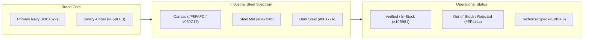
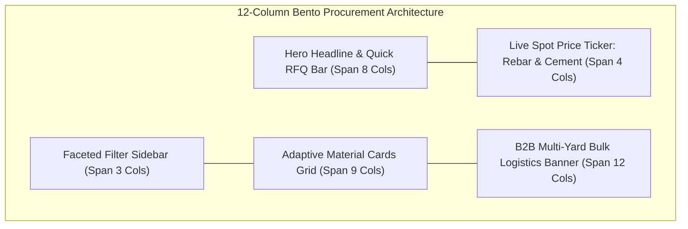
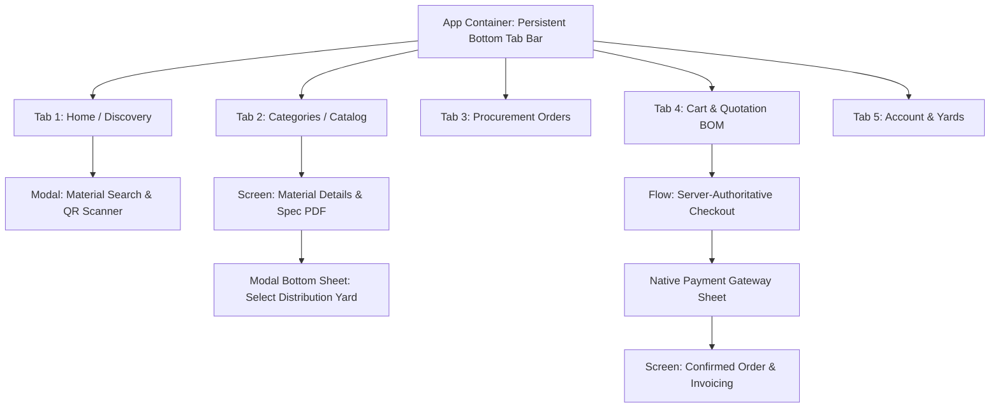

# BuildMart Unified Cross-Platform Design System (DESIGN.md)

*Standard: Google Stitch Semantic Design Specification & UI/UX Pro Max Cross-Platform Architecture*  
*Monorepo Scope: Web (Next.js 15 / React 19 / Tailwind CSS) + Mobile (Flutter 3.x / Riverpod 2)*  
*Single Source of Truth: `packages/shared/src/theme.ts`*

---

## 1. Shared Design Tokens (Single Source of Truth)

All color tokens guarantee minimum **4.5:1 contrast ratio** for standard text and **3:1** for graphical user interface components against their respective backgrounds, fully compliant with WCAG AA and AAA standards across both desktop displays and mobile OLED screens.

### 1.1 Color Palette & Semantic Roles



| Token Identifier | Light Mode Hex | Dark Mode Hex | Functional Role | Contrast Ratio |
| :--- | :--- | :--- | :--- | :---: |
| `primary.DEFAULT` | `#0B1527` | `#93CCFF` | Primary brand identity, headers, heavy actions | 17.2:1 (Light) / 8.6:1 (Dark) |
| `primary.surface` | `#111E36` | `#181C20` | Navigation bars, container cards, dialog headers | 14.8:1 (Light) / 7.2:1 (Dark) |
| `accent.DEFAULT` | `#F59E0B` | `#FBBF24` | Primary call to action, active tab highlights, badges | 4.8:1 vs text / 3.2:1 vs UI |
| `accent.hover` | `#D97706` | `#F59E0B` | Interactive hover and active depression state | 5.4:1 |
| `surface.canvas` | `#F8FAFC` | `#060C17` | Root application background canvas | Baseline |
| `surface.card` | `#FFFFFF` | `#0B1527` | Content cards, product cards, bottom sheets | 1.1:1 vs canvas |
| `border.subtle` | `#E2E8F0` | `rgba(255, 255, 255, 0.08)` | Structural dividers, inactive card borders | 1.3:1 vs canvas |
| `border.focus` | `#F59E0B` | `#FBBF24` | Keyboard focus ring, active form input stroke | 3.5:1 vs canvas |
| `semantic.success`| `#10B981` | `#34D399` | In-stock inventory, verified supplier, paid order | 4.6:1 |
| `semantic.error` | `#EF4444` | `#F87171` | Stock depletion, validation errors, payment failed| 4.7:1 |
| `semantic.info` | `#3B82F6` | `#60A5FA` | Tax calculations, GST breakdown, spec PDF download| 4.5:1 |
| `text.primary` | `#0B1527` | `#F8FAFC` | Main headings, product titles, numerical prices | 17.2:1 |
| `text.secondary` | `#475569` | `#94A3B8` | Technical specifications, delivery ETAs, subtitles| 7.4:1 |
| `text.muted` | `#64748B` | `#64748B` | Captions, timestamps, secondary metadata | 4.6:1 |

### 1.2 Typographic Hierarchy & Font Stacks

- **Primary Heading Stack**: `Outfit`, `Rubik`, sans-serif (Geometric industrial precision, clean numeric characters for dimensional lengths, tonnage, and metric pricing).
- **Body & Interface Stack**: `Inter`, `Nunito Sans`, sans-serif (High legibility at compact body sizes and data-dense tables).
- **Technical & Monospace Stack**: `JetBrains Mono`, monospace (SKU numbers, HSN/SAC codes, and GST accounting tables).

#### Web Fluid Scale vs. Native Mobile Scale
| Scale Tier | Web Typography (CSS Clamp) | Mobile Typography (Flutter dp/pt) | Weight | Letter Spacing |
| :--- | :--- | :--- | :---: | :---: |
| **Display** | `clamp(2.5rem, 5vw, 4rem)` | `32pt / LineHeight 38pt` | 700 (Bold) | `-0.02em` |
| **Heading 1** | `clamp(2rem, 4vw, 3rem)` | `24pt / LineHeight 30pt` | 700 (Bold) | `-0.015em` |
| **Heading 2** | `clamp(1.5rem, 3vw, 2.25rem)`| `20pt / LineHeight 26pt` | 600 (SemiBold) | `-0.01em` |
| **Headline** | `clamp(1.25rem, 2vw, 1.75rem)`| `17pt / LineHeight 22pt` | 600 (SemiBold) | Normal |
| **Body Large** | `1.125rem / LineHeight 1.6` | `16pt / LineHeight 22pt` | 400 (Regular) | Normal |
| **Body Standard**| `1.0rem / LineHeight 1.5` | `14pt / LineHeight 20pt` | 400 (Regular) | Normal |
| **Caption / Meta**| `0.75rem / LineHeight 1.4` | `12pt / LineHeight 16pt` | 500 (Medium) | `+0.01em` |
| **Tabular Numbers**| `0.875rem (font-mono)` | `12pt / Tabular Figures` | 600 (SemiBold) | `+0.02em` |

### 1.3 Spacing Scale & Elevation Depths

- **Baseline Spacing Unit**: `4px` (`space-xs: 4px`, `space-sm: 8px`, `space-md: 16px`, `space-lg: 24px`, `space-xl: 32px`, `space-2xl: 48px`, `space-3xl: 64px`).
- **Web Elevation (Soft Ambient Diffuse)**:
  - Base Card: `box-shadow: 0 4px 20px -2px rgba(11, 21, 39, 0.08)`
  - Hover Card: `box-shadow: 0 12px 30px -4px rgba(11, 21, 39, 0.14)`
  - Floating Modal / Drawer: `box-shadow: 0 24px 60px -12px rgba(11, 21, 39, 0.35)`
- **Mobile Elevation (Material Physical Inset)**:
  - Base Card: `elevation: 2.0` (Ambient shadow radius 6, color `Color(0x140B1527)`)
  - Floating Bottom Sheet: `elevation: 12.0`
  - Sticky Bottom Bar: `elevation: 8.0`

---

## 2. Web Layout Architecture (Workspace: `apps/web`)

### 2.1 Viewport Breakpoints & 12-Column Responsive Flow

```
Mobile (<640px)      -> Single column stacked, full-width touch cards, sticky bottom CTA bar
Tablet (640-1023px)  -> 2-column asymmetric grid, collapsible filter sidebar sheet
Desktop (1024-1439px)-> 3-column catalog grid, persistent left filter rail (280px), top sticky search
Wide (>=1440px)      -> 4-column Bento layout, max-w-[1440px] centered container, 24px gutter
```

### 2.2 Bento Grid & Catalog Composition



### 2.3 Strict Web Ergonomics & Anti-Slop Directives

1. **Click Targets & Keyboard Focus**:
   - Every interactive element (buttons, category chips, quantity steppers, cart toggles) enforces a minimum clickable bounding box of **$44 \times 44\text{px}$**.
   - Visible focus indicator: `outline: 2px solid #F59E0B; outline-offset: 2px` on all `:focus-visible` elements.
2. **Zero Layout Shifts (CLS = 0)**:
   - Product imagery wells reserve explicit aspect ratios (`aspect-square` or `aspect-[4/3]`) with blurred shimmer skeleton placeholders during hydration.
3. **Spatial Micro-Interactions (Framer Motion / CSS)**:
   - Card Hover: `transform: translateY(-4px)` with duration `250ms cubic-bezier(0.16, 1, 0.3, 1)`.
   - Cart Drawers: Smooth ease-out slide with `backdrop-filter: blur(8px)`.
   - Never snap instantly: All transitions require minimum `150ms-250ms` deceleration easing.

---

## 3. Mobile Screen & Navigation Blueprints (Workspace: `mobile`)

### 3.1 Mobile Hardware Viewports & Safe Area Clearances

- **Android Reference Viewport**: `412 × 915 dp` (Google Pixel 8/9 / Samsung Galaxy S24 standard).
- **iOS Reference Viewport**: `390 × 844 pt` (iPhone 15/16 standard).
- **Safe Area Clearances**:
  - Top Inset: Status bar notch / Dynamic Island (`MediaQuery.of(context).padding.top` ~ `24dp` to `59pt`).
  - Bottom Inset: Gesture pill navigation bar (`MediaQuery.of(context).padding.bottom` ~ `16dp` to `34pt`).
  - Horizontal Screen Gutters: `16dp` standard gutter, `12dp` card interior padding.

### 3.2 Thumb-Zone Ergonomic Mapping

```
+-----------------------------------+  [0% - 15% Screen Height]
|  Top Inset (Status / System Clock)|  Extreme Reach (Read-only status, back arrow)
|  Search Bar & Location Dropdown   |
+-----------------------------------+  [15% - 55% Screen Height]
|                                   |  Neutral Reach
|  Material Catalog Swiper / Grid   |  Browsing & vertical scrolling
|  Product Specifications Sheet     |  Pinch, zoom, technical diagrams
|                                   |
+-----------------------------------+  [55% - 85% Screen Height]
|  Quantity Stepper / Yard Selector |  Natural Thumb Comfort Zone
|  Primary "Add to Cart" Pill Button|  Primary high-frequency interactions
+-----------------------------------+  [85% - 100% Screen Height]
|  Persistent 5-Tab Navigation Bar  |  Instant Thumb Switching
+-----------------------------------+  (Home | Categories | Orders | Cart | Profile)
```

### 3.3 Native Mobile Navigation Hierarchy



### 3.4 Touch Targets, Spring Physics & Haptics

1. **Hit Targets**:
   - Android minimum touch target: **$48 \times 48\text{ dp}$**.
   - iOS minimum touch target: **$44 \times 44\text{ pt}$**.
   - Compact icons (e.g., delete item, stepper `-` / `+`) wrap inside `Padding` or `IconButton` guaranteeing the minimum bounding box.
   - Minimum clear spacing between adjacent clickable items: **`8dp`**.
2. **Tactile Feedback & Physics**:
   - Button press state uses a scale-down animation (`scale: 0.96`, duration `100ms`, curve `Curves.easeOutCubic`) accompanied by `HapticFeedback.lightImpact()`.
   - Modal bottom sheets feature drag handles (`36 × 4dp` pill, color `#CBD5E1`) with clamped snap points (`collapsed: 0.4`, `expanded: 0.85`).
   - Horizontal category scrollers use `ClampingScrollPhysics` on Android and `BouncingScrollPhysics` on iOS to preserve platform familiarity.

---

## 4. Platform Execution & Anti-Slop Safeguards

| Feature Domain | Web Architecture (`apps/web`) | Mobile Architecture (`mobile`) | Explicitly Forbidden (Anti-Slop Directives) |
| :--- | :--- | :--- | :--- |
| **Color Application** | Light mode default with Slate-900 typography; Dark mode enabled via system media query. | Dynamic high-contrast surfaces (`#FFFFFF` Light / `#060C17` Dark OLED). | **Banned**: Purple/pink neon AI gradients, uncalibrated saturation > 85%, pure `#000000` text on grey. |
| **Elevation & Depth** | Weightless floating cards with soft ambient drop-shadows; subtle 1px border stroke. | Material elevation `2.0` with sharp tactile edges; modal bottom sheet elevation `12.0`. | **Banned**: Heavy muddy drop-shadows (`rgba(0,0,0,0.5)`), flat unbordered cards on identical backgrounds. |
| **Interactions** | Hover states (`translateY(-2px)`, shadow lift); visible keyboard focus outlines. | Native active press scale (`0.96`), tactile haptic impulse, safe-area padded touch zones. | **Banned**: Hover-dependent interactions on mobile; instant 0ms state jumps; desktop scrollbars on phone screens. |
| **Layout Physics** | Responsive 12-column CSS Grid; fluid clamp typography; zero content overlap. | Thumb-zone optimized; bottom tab navigation (5 tabs max); native slivers and bottom sheets. | **Banned**: Fixed pixel widths exceeding screen bounds (`w-[1200px]` on mobile); layout shifts (CLS > 0.05). |
| **Loading & Errors** | Dimensionally accurate skeleton placeholders; inline validation feedback. | Flutter Shimmer placeholder blocks; non-blocking SnackBar alerts with retry action triggers. | **Banned**: Full-screen blocking spinners; uninformative error dialogs (`Error: Something went wrong`). |

---

## 5. Architectural References & Linked Sources

- **Shared Token Implementation**: [`packages/shared/src/theme.ts`](file:///d:/buildmart/packages/shared/src/theme.ts)
- **Web Tailwind Configuration**: [`apps/web/tailwind.config.ts`](file:///d:/buildmart/apps/web/tailwind.config.ts)
- **Mobile Color Constants**: [`mobile/lib/core/constants/app_colors.dart`](file:///d:/buildmart/mobile/lib/core/constants/app_colors.dart)
- **Architecture Wiki Guide**: [`docs/wiki/Architecture.md`](file:///d:/buildmart/docs/wiki/Architecture.md)
- **Mobile Engineering Guide**: [`docs/wiki/Mobile-Engineering.md`](file:///d:/buildmart/docs/wiki/Mobile-Engineering.md)
