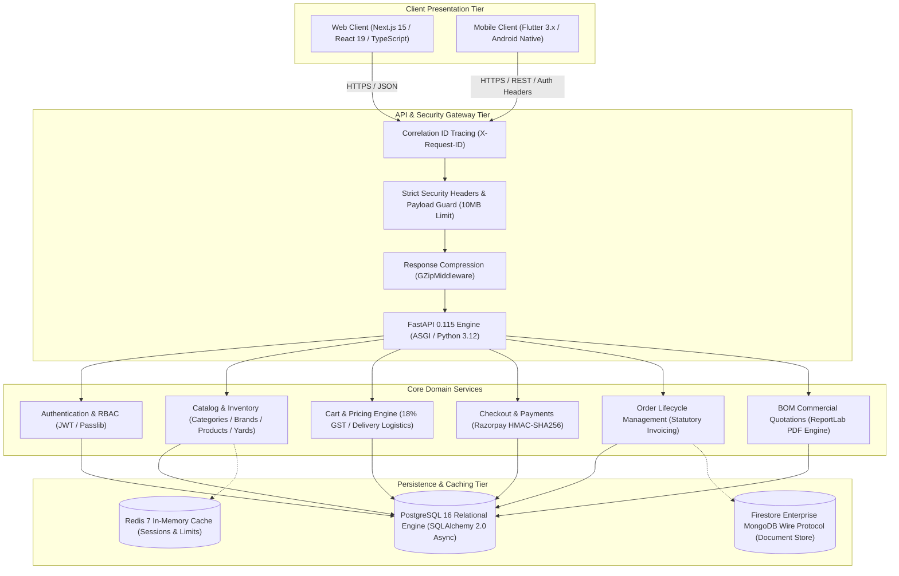

# BuildMart

Production-grade construction materials marketplace and commercial procurement platform managed as a pnpm monorepo with a Next.js 15 frontend, FastAPI Python backend, shared TypeScript domain library, and Flutter mobile application.

[](https://github.com/KatkamKoushik/BuildMart/actions/workflows/ci-web.yml)
[](https://github.com/KatkamKoushik/BuildMart/actions/workflows/ci-api.yml)
[](https://github.com/KatkamKoushik/BuildMart/actions/workflows/flutter_ci.yml)
[](https://github.com/KatkamKoushik/BuildMart/actions/workflows/security-audit.yml)
[](https://github.com/KatkamKoushik/BuildMart/releases)
[](services/api/tests)
[](https://nextjs.org/)
[](https://react.dev/)
[](https://fastapi.tiangolo.com/)
[](https://www.python.org/)
[](https://www.typescriptlang.org/)
[](https://flutter.dev/)
[](https://www.postgresql.org/)
[](https://pnpm.io/)
[](https://turbo.build/)

---

## Executive Summary

BuildMart is a digital procurement platform purpose-built for the building construction industry. By bridging the gap between primary manufacturers (such as UltraTech, Tata Tiscon, Ambuja, and Berger) and certified regional material yards, BuildMart enables contractors, infrastructure developers, and builders to procure high-specification materials at transparent factory-direct prices with guaranteed statutory 18% GST Input Tax Credit (ITC) compliance.

---

## Technical Documentation and Wiki

Detailed architectural deep-dives, entity relationship diagrams, security policies, and deployment manuals are maintained in the project Wiki:

| Wiki Module | Technical Scope and Architecture | Live GitHub Wiki | Repository Mirror |
| :--- | :--- | :--- | :--- |
| **Wiki Portal Index** | Documentation index, system tenets, and technology stack overview | [Wiki Home](https://github.com/KatkamKoushik/BuildMart/wiki) | [Home.md](docs/wiki/Home.md) |
| **System Architecture** | 3-tier boundary breakdown, Monorepo layout, and request lifecycles | [Architecture](https://github.com/KatkamKoushik/BuildMart/wiki/Architecture) | [Architecture.md](docs/wiki/Architecture.md) |
| **Database & Persistence** | PostgreSQL 16 schema, ER diagram, migrations, and Firestore wire | [Database & Persistence](https://github.com/KatkamKoushik/BuildMart/wiki/Database-and-Persistence) | [Database-and-Persistence.md](docs/wiki/Database-and-Persistence.md) |
| **Authentication & Security** | JWT auth lifecycle, RBAC enforcement matrix, and HTTP security | [Authentication & Security](https://github.com/KatkamKoushik/BuildMart/wiki/Authentication-and-Security) | [Authentication-and-Security.md](docs/wiki/Authentication-and-Security.md) |
| **Payments & Orders** | Razorpay flow, HMAC verification, webhooks, and state machine | [Payments & Orders](https://github.com/KatkamKoushik/BuildMart/wiki/Payments-and-Orders) | [Payments-and-Orders.md](docs/wiki/Payments-and-Orders.md) |
| **Mobile Engineering** | Flutter 3.x, Riverpod 2, keystore isolation, and 15s timeouts | [Mobile Engineering](https://github.com/KatkamKoushik/BuildMart/wiki/Mobile-Engineering) | [Mobile-Engineering.md](docs/wiki/Mobile-Engineering.md) |
| **CI/CD & Quality Gates** | GitHub Actions multi-tier matrix, Node 24 runtimes, and audit gates | [CI/CD & Quality Gates](https://github.com/KatkamKoushik/BuildMart/wiki/CI-CD-and-Quality-Gates) | [CI/CD-and-Quality-Gates.md](docs/wiki/CI-CD-and-Quality-Gates.md) |
| **Deployment & Operations** | Docker Compose topology, health checks, logging, and runbooks | [Deployment & Operations](https://github.com/KatkamKoushik/BuildMart/wiki/Deployment-and-Operations) | [Deployment-and-Operations.md](docs/wiki/Deployment-and-Operations.md) |

---

## System Architecture



---

## Commercial Procurement Workflow

```mermaid
flowchart LR
    subgraph Step1["1. Sourcing"]
        Browse["Browse Certified Catalog<br/>(Cement, Steel, Bricks)"]
        YardSelect["Select Regional Distribution Yard<br/>(Proximity & Stock)"]
    end

    subgraph Step2["2. Estimation"]
        AddToCart["Add to Cart or BOM"]
        QuoteGen["Generate Branded Quotation<br/>(ReportLab PDF with GST)"]
    end

    subgraph Step3["3. Checkout"]
        OrderCreate["Create Razorpay Order"]
        PaymentSign["Authorize & Verify Signature<br/>(HMAC-SHA256 Server Validation)"]
    end

    subgraph Step4["4. Fulfillment"]
        YardPick["Yard Inventory Allocation"]
        FleetDispatch["Logistics Fleet Dispatch"]
        Delivery["Site Gate Receipt & 18% GST Invoice"]
    end

    Browse --> YardSelect --> AddToCart --> QuoteGen --> OrderCreate --> PaymentSign --> YardPick --> FleetDispatch --> Delivery
```



---

## Domain Capabilities Mindmap

```mermaid
flowchart TD
    BuildMartRoot["BuildMart Platform"]

    BuildMartRoot --> DomainCatalog["1. Catalog & Materials"]
    DomainCatalog --> CatCategories["16 Categories (Cement, Steel, Bricks, Plumbing)"]
    DomainCatalog --> CatBrands["18 Primary Brands (UltraTech, Tata Tiscon, Berger)"]
    DomainCatalog --> CatYards["Verified Regional Distribution Hubs"]
    DomainCatalog --> CatSpecs["Technical Specifications & Mill Certificates"]

    BuildMartRoot --> DomainCommercial["2. Commercial Engine"]
    DomainCommercial --> CommPricing["Server-Authoritative Pricing"]
    DomainCommercial --> CommTax["Statutory 18% GST & Input Tax Credit (ITC)"]
    DomainCommercial --> CommBOM["Bill of Materials (BOM) Estimation"]
    DomainCommercial --> CommPDF["ReportLab PDF Quotation Generation"]

    BuildMartRoot --> DomainSecurity["3. Security & Payments"]
    DomainSecurity --> SecAuth["OAuth2 JWT Authentication & RBAC"]
    DomainSecurity --> SecRazorpay["Razorpay Dual-Verification (HMAC-SHA256)"]
    DomainSecurity --> SecWebhooks["Raw-Body Webhook Replay Deduplication"]
    DomainSecurity --> SecHeaders["Strict CSP, HSTS, and 10MB Body Limits"]

    BuildMartRoot --> DomainClients["4. Multi-Platform Clients"]
    DomainClients --> ClientWeb["Next.js 15 App Router & React 19 Web App"]
    DomainClients --> ClientMobile["Flutter 3.x Android Client with Riverpod 2"]
    DomainClients --> ClientStorage["Android Keystore Hardware Token Isolation"]
    DomainClients --> ClientResilience["15-Second Deadline with 408/503 Fallbacks"]
```



---

## Repository Structure

```text
buildmart/
├── apps/
│   └── web/                   # Next.js 15 (App Router, React 19, TypeScript, Tailwind CSS)
│       ├── src/app/           # Home, Products, Product Detail, Checkout, Orders, Quotes, Shops
│       ├── src/components/    # Header, Footer, CartDrawer, HeroBanners, FeaturedProducts
│       ├── src/stores/        # Zustand client state management
│       └── src/lib/           # Typed API Client, formatters, and utilities
│
├── services/
│   └── api/                   # Python FastAPI Backend
│       ├── app/api/v1/        # Products, Categories, Brands, Shops, Cart, Orders, Checkout, Quotes
│       ├── app/models/        # SQLAlchemy 2.0 ORM Declarative Models
│       ├── app/schemas/       # Pydantic v2 Request and Response Schemas
│       ├── app/core/          # Configuration, Security, and Authentication
│       ├── app/db/            # Session handling, Async Engine, and MongoDB Wire Module
│       ├── app/seed.py        # Seed pipeline importing 210 products and 16 categories
│       ├── tests/             # Automated Pytest Integration Suite (48 tests)
│       └── Dockerfile         # Production Container Definition
│
├── packages/
│   └── shared/                # Shared TypeScript Domain Types and Zod Schemas
│       ├── src/types.ts       # Unified data models
│       └── src/schemas.ts     # Zod runtime validation
│
├── mobile/                    # Flutter Mobile Application (iOS and Android)
│   ├── lib/                   # Riverpod 2, Freezed, GoRouter, SecureStorage, ApiClient
│   └── test/                  # Flutter Unit and Widget Test Suite
│
├── docs/
│   └── wiki/                  # Comprehensive Engineering Wiki Documentation
│
├── infra/
│   └── docker-compose.yml     # PostgreSQL 16, Redis 7, and FastAPI Service
│
├── .github/workflows/
│   ├── security-audit.yml     # Secret leak audits and dependency security gates
│   ├── ci-web.yml             # Next.js Typecheck and Build Pipeline (Node 24 native)
│   ├── ci-api.yml             # FastAPI Seed and Pytest Suite Pipeline (Node 24 native)
│   └── flutter_ci.yml         # Mobile Flutter Test and APK Build Pipeline
│
├── pnpm-workspace.yaml        # pnpm Workspace Package Definitions
├── turbo.json                 # Turborepo Build Cache and Task Orchestration
└── .env.example               # Unified Monorepo Environment Configuration
```

---

## Technology Stack

### Frontend ([apps/web](apps/web))
- Framework: Next.js 15 (App Router, React Server Components)
- Language: TypeScript 5.8
- UI & Styling: React 19, Tailwind CSS with industrial construction palette
- State Management: Zustand (Cart, Wishlist, UI Drawers)
- Icons: Lucide React

### Backend ([services/api](services/api))
- Framework: FastAPI 0.115
- Language: Python 3.12
- ORM: SQLAlchemy 2.0 (Async Engine)
- Relational Database: PostgreSQL 16 (with SQLite/aiosqlite development fallback)
- Document Store: Google Cloud Firestore Enterprise MongoDB Wire Protocol
- In-Memory Cache: Redis 7
- Data Validation: Pydantic v2
- PDF Generation: ReportLab Dynamic PDF Engine
- Payment Verification: Razorpay Python SDK with HMAC-SHA256 signature validation
- Testing: Pytest with HTTPX AsyncClient

### Shared Library ([packages/shared](packages/shared))
- Language: TypeScript
- Design Tokens: Unified cross-platform brand tokens, typography scales, and spacing in [packages/shared/src/theme.ts](packages/shared/src/theme.ts)
- Validation: Zod schemas for addresses, cart operations, checkout, and quote requests

### Mobile Client ([mobile](mobile))
- Framework: Flutter 3.x
- State Management: Riverpod 2 with code generation
- Navigation: GoRouter with declarative deep linking
- Keystore Storage: `flutter_secure_storage` backed by Android Keystore provider
- Network Resilience: 15-second operation timeout with explicit HTTP 408 / 503 error translation

---

## Getting Started

### Prerequisites
- Node.js: >= 20.0.0 (CI standardizes on Node 24)
- pnpm: 12.4.2 (`npm i -g pnpm@12.4.2`)
- Python: >= 3.12 with pip
- Docker: Docker Desktop or Docker Engine with Docker Compose

### 1. Clone the Repository
```bash
git clone https://github.com/KatkamKoushik/BuildMart.git
cd buildmart
```

### 2. Configure Environment Variables
Copy the unified environment template:
```bash
cp .env.example .env
```

### 3. Install Monorepo Dependencies
```bash
pnpm install
```

### 4. Setup Database and Run Migrations
```bash
cd services/api
pip install -r requirements.txt
alembic upgrade head

# Optional: Populate initial development catalog data (disabled in production)
python -m app.seed
cd ../..
```

The seed pipeline initializes:
- 16 Material Categories (Cement, Steel, Bricks, Plumbing, Electricals, Tiles, Paints, etc.)
- 18 Manufacturer Brands (UltraTech, Tata Tiscon, Berger, Astral, CenturyDoors, Jaquar, etc.)
- 3 Verified Distribution Yards
- 210 Catalog Products with specifications, images, and prices
- 8 Promotional Banners
- Default Demo User account for testing

### 5. Start Development Servers
From repository root, launch frontend and backend services concurrently:
```bash
pnpm dev
```

Or run each service independently:
```bash
# Next.js Web Application (http://localhost:3000)
pnpm dev:web

# FastAPI Backend Server (http://localhost:8000 | Interactive Docs: http://localhost:8000/docs)
pnpm dev:api
```

---

## Testing and Quality Verification

### Monorepo Full Test Suite (Concurrent Execution)
`ash
# Runs test suites across all packages concurrently via Turborepo
pnpm test
`

### Typecheck Shared Domain Package
```bash
pnpm --filter @buildmart/shared typecheck
```

### Typecheck and Build Next.js Application
```bash
pnpm --filter @buildmart/web typecheck
pnpm --filter @buildmart/web build
```

### Run Python API Test Suite
```bash
cd services/api
pytest -v
cd ../..
```

### Run Database Migration Integrity and Rollback Test
```bash
python -m pytest services/api/tests/test_migrations.py -v
```

### Run Mobile Static Analysis and Unit Tests
```bash
cd mobile
dart format --output=none --set-exit-if-changed .
dart analyze --fatal-infos
flutter test --coverage
cd ..
```

---

## API Endpoints Reference

All endpoints are versioned under `/api/v1`:

| Method | Endpoint | Description |
| :--- | :--- | :--- |
| `GET` | `/health` | Service health status, database ping, and environment |
| `GET` | `/categories` | List material categories with live product counts |
| `GET` | `/categories/{id}` | Retrieve specific category details |
| `GET` | `/brands` | List manufacturer brands with category filtering |
| `GET` | `/banners` | Retrieve active promotional banners |
| `GET` | `/shops` | List verified material yards and suppliers with proximity |
| `GET` | `/shops/{id}` | Retrieve supplier yard details |
| `GET` | `/shops/{id}/products` | List products supplied by specific yard |
| `GET` | `/products` | Filter products by category, brand, shop, search query, price, sorting |
| `GET` | `/products/{id}` | Retrieve product details and specifications |
| `GET` | `/cart` | Retrieve current user cart with subtotal, 18% GST, and delivery fees |
| `POST` | `/cart/items` | Add product to cart |
| `PUT` | `/cart/items/{id}` | Update quantity of cart item |
| `DELETE` | `/cart/items/{id}` | Remove item from cart |
| `DELETE` | `/cart` | Clear entire cart |
| `POST` | `/checkout/razorpay/create-order` | Generate Razorpay order ID |
| `POST` | `/checkout/razorpay/verify` | Verify Razorpay payment signature via HMAC-SHA256 |
| `POST` | `/checkout/razorpay/webhook` | Process Razorpay raw-body webhooks with replay deduplication |
| `POST` | `/orders` | Place new order with site delivery address |
| `GET` | `/orders` | List user order history |
| `GET` | `/orders/{id}` | Retrieve order status and tracking timeline |
| `POST` | `/orders/{id}/cancel` | Cancel eligible pending or confirmed order |
| `PUT` | `/orders/{id}/status` | Update order lifecycle status (Admin only) |
| `POST` | `/quotes` | Submit commercial project quote request |
| `GET` | `/quotes/{id}/pdf` | Download dynamically generated branded PDF quotation |
| `POST` | `/auth/token` | Obtain signed JWT access token |
| `GET` | `/auth/me` | Retrieve active user profile |
| `POST` | `/auth/address` | Add delivery address to user account |
| `GET` | `/admin/metrics` | Retrieve platform KPI summary and sales metrics (Admin only) |
| `GET` | `/admin/orders` | List all platform orders across all users (Admin only) |
| `POST/PUT/DELETE` | `/admin/products` | Manage product catalog entries (Admin only) |

---

## Cross-Platform Design System

The unified design specification is documented in [DESIGN.md](DESIGN.md), establishing shared brand tokens, responsive 12-column Bento layouts for Web, and native ergonomics (touch targets >= 48dp, safe areas, haptic feedback) for Mobile:
- **Shared Tokens**: [packages/shared/src/theme.ts](packages/shared/src/theme.ts)
- **Specification Blueprint**: [DESIGN.md](DESIGN.md)

---

## Security Policies and Compliance

- **Zero Untracked Secrets**: Secrets reside strictly in `.env` or CI secret vaults. Active and valid keys are prohibited in Git via pre-push audit gates.
- **Server-Authoritative Pricing**: All order computations are performed server-side. Client-supplied price and tax calculations are discarded.
- **Payload Guard**: API payloads exceeding 10 Megabytes are rejected at the gateway layer (HTTP 413).
- **Hardened HTTP Headers**: Responses enforce `X-Content-Type-Options: nosniff`, `X-Frame-Options: DENY`, `X-XSS-Protection: 1; mode=block`, and Content Security Policy.
- **Hardware Isolation**: Mobile authentication tokens are stored in hardware-backed Android Keystore via `flutter_secure_storage`.
- **Statutory Tax Compliance**: Guaranteed 18% GST calculation with Input Tax Credit (ITC) eligibility.

---

## Architecture Decision Records (ADRs)

Core architectural decisions are tracked under [docs/adr](docs/adr):

| ADR | Title | Status | Summary |
| :--- | :--- | :--- | :--- |
| [0001](docs/adr/0001-dual-database-persistence.md) | Dual Database Persistence | Accepted | PostgreSQL 16 relational ledger + Firestore MongoDB wire protocol |
| [0002](docs/adr/0002-pnpm-turborepo-monorepo.md) | pnpm & Turborepo Monorepo | Accepted | pnpm 12 workspaces with Turborepo task pipeline caching |
| [0003](docs/adr/0003-server-authoritative-procurement.md) | Server-Authoritative Procurement | Accepted | Server pricing, statutory 18% GST invariants, and Razorpay HMAC verification |

---

## Repository Governance and Security

- [LICENSE](LICENSE): Open-source MIT License.
- [SECURITY.md](SECURITY.md): Responsible disclosure policy, SLA, and security invariant definitions.
- [CONTRIBUTING.md](CONTRIBUTING.md): Developer setup, code review conventions, and branch policies.

---

## Releases and Changelog

Official release packages, tags, and changelogs are tracked on [GitHub Releases](https://github.com/KatkamKoushik/BuildMart/releases):

- [Release v2.0.0](https://github.com/KatkamKoushik/BuildMart/releases/tag/v2.0.0)
  - Full-stack monorepo transformation with pnpm 12 and Turborepo.
  - Next.js 15 App Router web application with React 19.
  - Asynchronous FastAPI Python backend with SQLAlchemy 2.0 ORM.
  - Automated database seed pipeline importing 16 categories, 18 brands, and 210 products.
  - Dynamic ReportLab PDF commercial quotation generator.
  - Upgraded GitHub Actions pipelines to Node 24 native runtimes.
  - Comprehensive engineering Wiki documentation suite.
