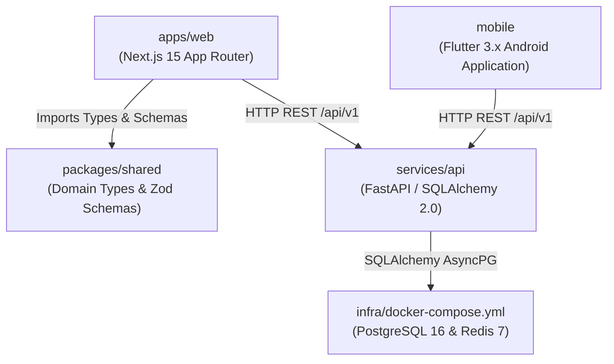
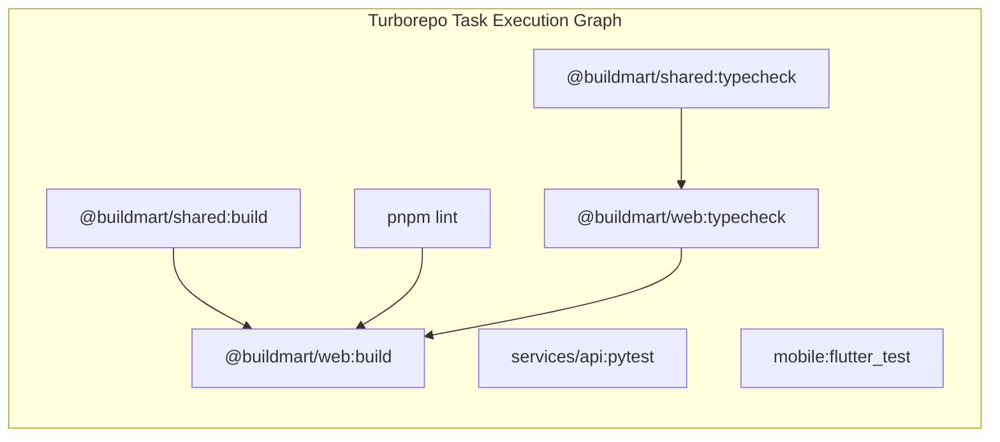
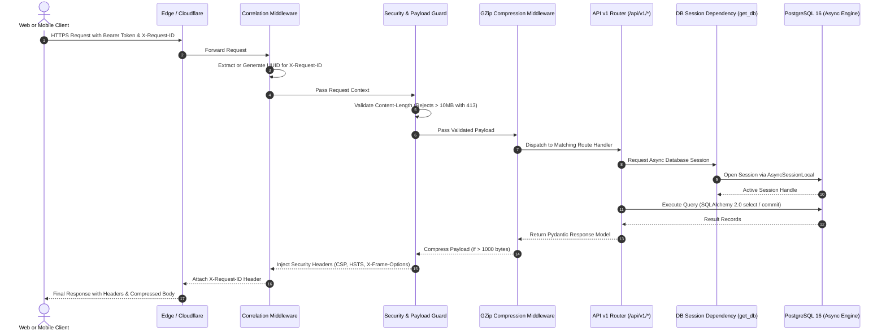

# System Architecture and Component Boundaries

This document provides a detailed breakdown of the BuildMart 3-Tier Enterprise architecture, module boundaries, monorepo dependency hierarchy, and cross-cutting request workflows.

Primary Source Files:
- [apps/web](file:///d:/buildmart/apps/web)
- [services/api/app/main.py](file:///d:/buildmart/services/api/app/main.py)
- [packages/shared](file:///d:/buildmart/packages/shared)
- [mobile/lib](file:///d:/buildmart/mobile/lib)
- [infra/docker-compose.yml](file:///d:/buildmart/infra/docker-compose.yml)

---

## Architecture Principles

BuildMart adheres to Clean Architecture and Hexagonal separation patterns:

1. **Independent Presentation Layer**:
   The web frontend ([apps/web](file:///d:/buildmart/apps/web)) and mobile client ([mobile](file:///d:/buildmart/mobile)) communicate with the backend exclusively via versioned HTTP REST interfaces (`/api/v1`). Neither presentation client connects directly to databases or caches.

2. **Server-Authoritative Core**:
   All business logic, pricing computations, tax calculations (statutory 18% GST), inventory validation, and payment verification reside inside the FastAPI application service ([services/api](file:///d:/buildmart/services/api)).

3. **Isolated Shared Domain Contracts**:
   Unified interfaces and validation rules are defined in [packages/shared](file:///d:/buildmart/packages/shared), eliminating divergence between frontend web contracts and backend serialization rules.

4. **Layered Request Pipeline**:
   Requests pass through security, correlation, and compression middlewares before reaching route controllers, keeping business handlers focused solely on domain execution.

---

## Monorepo Dependency Structure

The project is structured as a pnpm workspace orchestrated with Turborepo:

---

## Turborepo Build Pipeline Workflow

Turborepo orchestrates linting, typechecking, testing, and container builds with caching to optimize CI execution times:

---

## End-to-End Request Lifecycle

The diagram below details the path of an authenticated API request through the FastAPI gateway, middleware chain, database session dependency, and downstream storage:

---

## Cross-Cutting Gateway Middlewares

Implemented in [services/api/app/main.py](file:///d:/buildmart/services/api/app/main.py):

### 1. Request Correlation Tracing (`X-Request-ID`)
Every incoming request is inspected for an `X-Request-ID` header. If absent, a cryptographically random UUIDv4 is generated. This ID is passed to internal logs and returned in all response headers for distributed tracing and root cause investigation.

### 2. Payload Size Enforcement
Payloads exceeding `MAX_REQUEST_BODY_SIZE` (10 Megabytes) are rejected immediately at the gateway layer with HTTP 413 `Request Entity Too Large`, mitigating memory exhaustion and denial-of-service vulnerabilities.

### 3. Response Compression (`GZipMiddleware`)
All JSON and text responses exceeding 1,000 bytes are compressed with GZip, reducing bandwidth consumption for heavy catalog listings and Bill of Materials payloads.

### 4. Hardened Security Headers
Every outbound response includes production-grade security headers:
- `X-Content-Type-Options: nosniff` (prevention of MIME-sniffing)
- `X-Frame-Options: DENY` (clickjacking mitigation)
- `X-XSS-Protection: 1; mode=block`
- `Content-Security-Policy: default-src 'none'; frame-ancestors 'none'`
- `Referrer-Policy: strict-origin-when-cross-origin`
- `Strict-Transport-Security: max-age=31536000; includeSubDomains` (enabled in production environments)
