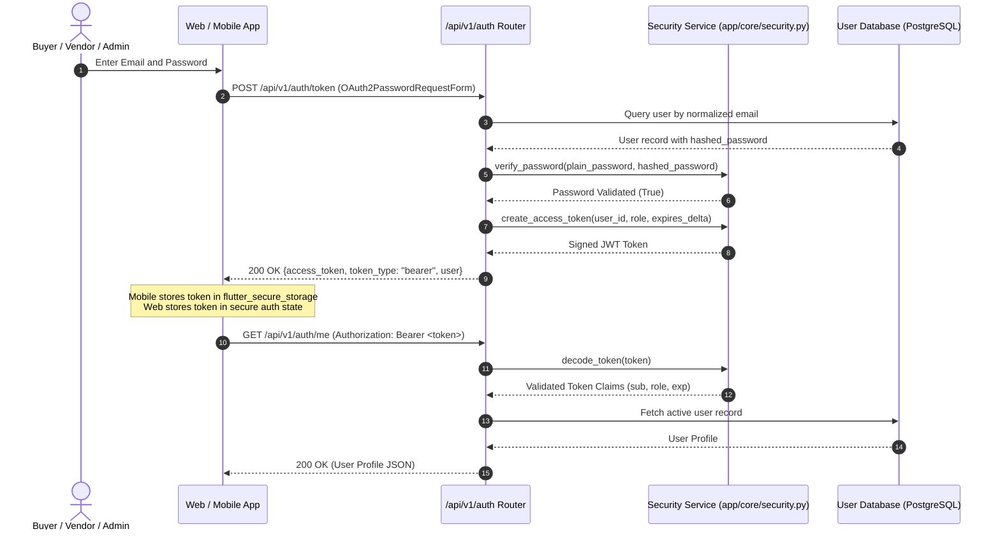
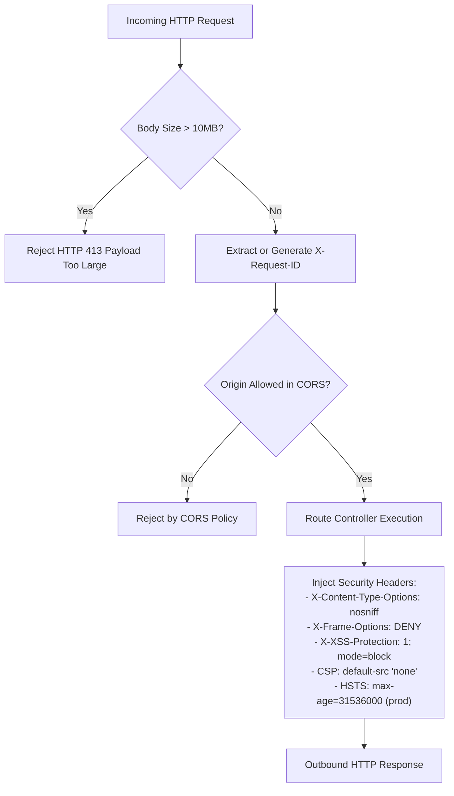

# Authentication and Security Architecture

This document outlines the authentication lifecycle, Role-Based Access Control (RBAC), gateway security middlewares, and secret defense mechanisms in BuildMart.

Primary Source Files:
- [services/api/app/api/v1/auth.py](../../services/api/app/api/v1/auth.py)
- [services/api/app/core/security.py](../../services/api/app/core/security.py)
- [services/api/app/main.py](../../services/api/app/main.py)
- [mobile/lib/core/security/secure_storage.dart](../../mobile/lib/core/security/secure_storage.dart)
- [.github/workflows/security-audit.yml](../../.github/workflows/security-audit.yml)

---

## Authentication Lifecycle

BuildMart issues signed JSON Web Tokens (JWT) using the HMAC-SHA256 algorithm. Tokens encapsulate the subject identifier, user role, and expiration timestamp.

---

## Role-Based Access Control (RBAC) Matrix

Permissions are enforced through FastAPI dependency injection decorators (`get_current_active_user`, `require_admin`, `require_vendor`):

| Resource / Endpoint | Buyer | Vendor | Admin | Enforcement Mechanism |
| :--- | :---: | :---: | :---: | :--- |
| `GET /api/v1/products` | Yes | Yes | Yes | Public read access |
| `POST /api/v1/cart/items` | Yes | Yes | Yes | Authenticated user session |
| `POST /api/v1/checkout/razorpay/*` | Yes | Yes | Yes | Authenticated buyer context |
| `POST /api/v1/quotes` | Yes | Yes | Yes | Authenticated / verified client |
| `GET /api/v1/admin/metrics` | No | No | Yes | `require_admin` dependency guard |
| `GET /api/v1/admin/orders` | No | No | Yes | `require_admin` dependency guard |
| `POST/PUT/DELETE /api/v1/admin/products` | No | No | Yes | `require_admin` dependency guard |
| `PUT /api/v1/orders/{id}/status` | No | Yes | Yes | Role check on order owning yard |

---

## Gateway Defense & HTTP Security Headers

Configured in [services/api/app/main.py](../../services/api/app/main.py):

---

## Client Credential Storage

### Mobile App (Flutter)
The mobile application isolates authentication credentials using `flutter_secure_storage`:
- **Android**: Uses Android Keystore provider with AES encryption and RSA key wrapping.
- **Cleartext Traffic**: Prohibited via Android Network Security Config ([mobile/android/app/src/main/res/xml/network_security_config.xml](../../mobile/android/app/src/main/res/xml/network_security_config.xml)), ensuring all API requests enforce HTTPS transport security.

### Web Application (Next.js 15)
Tokens are managed via Zustand client state and propagated in `Authorization: Bearer <token>` headers through the typed API client ([apps/web/src/lib/api.ts](../../apps/web/src/lib/api.ts)).

---

## Secret Defense and Pre-Push Verification

BuildMart implements a zero-trust secret management standard:

1. **Vault / Environment Isolation**:
   Master keys, payment secrets (`RAZORPAY_KEY_SECRET`), database credentials, and service account keys are supplied exclusively via runtime environment variables.

2. **Automated Secret Leak Auditing**:
   GitHub Actions CI includes a dedicated gate ([.github/workflows/security-audit.yml](../../.github/workflows/security-audit.yml)) verifying:
   - No private keys (`id_rsa`, `.pem`, `.pkcs12`) exist in git tracking.
   - Protected credential files (such as `google-services.json` containing live GCP keys) are blocked from git tracking.
   - Example configuration templates (e.g. `google-services.json.example`) contain strictly sanitized dummy tokens (`DUMMY_API_KEY_FOR_CI_VALIDATION_ONLY_0000`).
