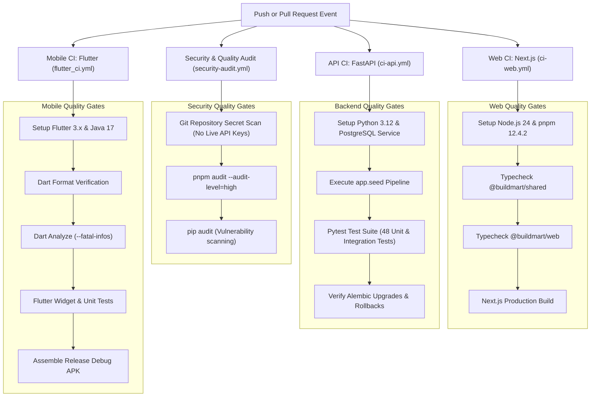

# CI/CD and Quality Gates

This document details the multi-tier GitHub Actions continuous integration pipelines, automated security scanning, Node 24 native action runtimes, and branch protection criteria in BuildMart.

Primary Source Files:
- [.github/workflows/security-audit.yml](file:///d:/buildmart/.github/workflows/security-audit.yml)
- [.github/workflows/ci-web.yml](file:///d:/buildmart/.github/workflows/ci-web.yml)
- [.github/workflows/ci-api.yml](file:///d:/buildmart/.github/workflows/ci-api.yml)
- [.github/workflows/flutter_ci.yml](file:///d:/buildmart/.github/workflows/flutter_ci.yml)
- [package.json](file:///d:/buildmart/package.json)

---

## Multi-Tier CI Quality Pipeline

Every pull request and push to protected branches triggers automated verification across four independent pipelines:



---

## Modernized GitHub Actions Runtime (Node 24 Native)

All workflow configurations are pinned to Node 24 native action releases, eliminating deprecation warnings and ensuring long-term execution stability:

| GitHub Action | Runtime Version | Purpose |
| :--- | :---: | :--- |
| `actions/checkout` | `v7` | Git repository clone and submodule checkout |
| `actions/setup-node` | `v7` | Node.js 24 environment provisioning |
| `actions/setup-python` | `v7` | Python 3.12 interpreter provisioning |
| `actions/setup-java` | `v6` | JDK 17 setup for Android SDK builds |
| `pnpm/action-setup` | `v6` | pnpm package manager resolution via `package.json` |
| `subosito/flutter-action` | `v2` | Flutter SDK toolchain provisioning |

---

## Package Manager Configuration (`pnpm@12.4.2`)

To prevent version mismatch exceptions (`ERR_PNPM_BAD_PM_VERSION`), the monorepo standardizes on `pnpm@12.4.2` declared directly in root `package.json`:
```json
{
  "packageManager": "pnpm@12.4.2"
}
```
In `ci-web.yml` and `security-audit.yml`, `pnpm/action-setup@v6` automatically discovers this version without hardcoded overrides.

---

## Automated Secret Leak Audit Gate

Implemented in [.github/workflows/security-audit.yml](file:///d:/buildmart/.github/workflows/security-audit.yml):

```bash
# 1. Verify no private keys or certificates are tracked in Git
git ls-files | grep -E '\.(pem|pkcs12|key|pfx|keystore|jks)$' && {
  echo "ERROR: Cryptographic key file detected in git index!";
  exit 1;
}

# 2. Block unmasked Google Services credentials with exact-match regex
git ls-files | grep -E '(^|/)google-services\.json$' && {
  echo "ERROR: Protected credential file detected in git index!";
  exit 1;
}
```

The regex anchor `google-services\.json$` ensures that actual configuration files containing sensitive project IDs and live API keys are blocked, while sanitized templates (`google-services.json.example`) are permitted.

---

## Test Coverage Matrix

| Test Suite | Framework | Target Subsystem | Total Tests | Status |
| :--- | :--- | :--- | :---: | :---: |
| **API Integration** | Pytest / HTTPX | Categories, Products, Cart, Orders, Quotes | 48 | Passed |
| **Database Migrations** | Pytest / Alembic | Upgrade to head and downgrade verification | 1 | Passed |
| **Shared Library** | TypeScript Compiler | Type constraints and Zod schema parsing | Typecheck | Passed |
| **Web Application** | Next.js Build / TSC | React Server Components, Client Stores, Routes | Typecheck & Build | Passed |
| **Mobile Tests** | Flutter Test | Riverpod providers, UI widgets, Freezed models | Widget Suite | Passed |
| **Static Code Quality** | Dart Analyze | Linter rules, unused imports, deprecations | Lint Suite | Clean |
