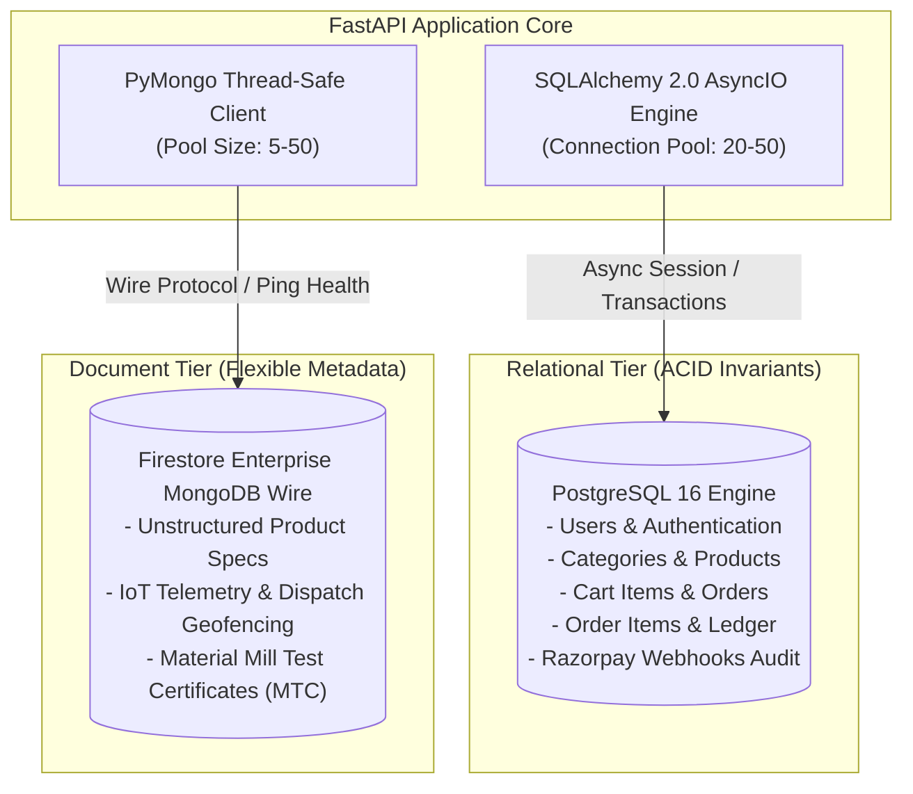
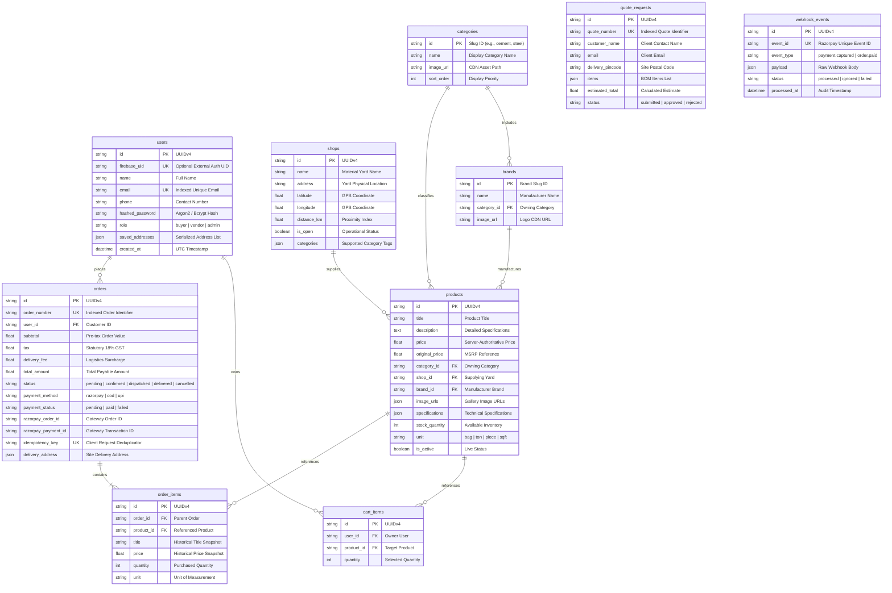

# Database and Persistence Architecture

This document describes the dual-database persistence tier of BuildMart, including the primary relational schema (PostgreSQL 16), migration workflows (Alembic), and document store integration (Google Cloud Firestore Enterprise MongoDB Wire Protocol).

Primary Source Files:
- [services/api/app/models/models.py](file:///d:/buildmart/services/api/app/models/models.py)
- [services/api/app/db/session.py](file:///d:/buildmart/services/api/app/db/session.py)
- [services/api/app/db/mongodb.py](file:///d:/buildmart/services/api/app/db/mongodb.py)
- [services/api/app/seed.py](file:///d:/buildmart/services/api/app/seed.py)
- [services/api/alembic](file:///d:/buildmart/services/api/alembic)

---

## Dual-Database Topology

BuildMart adopts a hybrid persistence strategy:



---

## Relational Entity-Relationship Diagram

The relational schema strictly enforces foreign key integrity, cascade deletions, and index optimization across all procurement entities:



---

## Migration Management with Alembic

Database schema evolutions are versioned and executed through Alembic.

### Running Migrations
To apply all pending revisions to head:
```bash
cd services/api
alembic upgrade head
```

### Creating Revisions
```bash
alembic revision --autogenerate -m "describe_schema_change"
```

### Migration Automated Verification
The repository contains an automated test [services/api/tests/test_migrations.py](file:///d:/buildmart/services/api/tests/test_migrations.py) that verifies migration upgrade and rollback integrity during CI builds.

---

## Firestore Enterprise MongoDB Wire Protocol Integration

For document storage, audit logging, and flexible specifications, BuildMart integrates with Google Cloud Firestore's MongoDB compatibility wire protocol using PyMongo:

Source implementation: [services/api/app/db/mongodb.py](file:///d:/buildmart/services/api/app/db/mongodb.py)

Key configurations:
- `serverSelectionTimeoutMS`: 5,000 ms
- `connectTimeoutMS`: 5,000 ms
- `socketTimeoutMS`: 10,000 ms
- `maxPoolSize`: 50 connections
- `minPoolSize`: 5 connections

Health verification is exposed on `/api/v1/health` where `ping` commands verify active connectivity to the document store.

---

## Database Seeding Pipeline

Source: [services/api/app/seed.py](file:///d:/buildmart/services/api/app/seed.py)

During local development and automated testing, the seeding pipeline executes automatically on application lifespan startup:
- **16 Material Categories**: Cement, Steel, Bricks, Plumbing, Electricals, Tiles, Paints, Hardware, Sanitaryware, etc.
- **18 Primary Brands**: UltraTech, Tata Tiscon, Ambuja, Berger, Astral, Jaquar, CenturyDoors, etc.
- **3 Verified Distribution Yards**: Regional yards with physical addresses and geo-coordinates.
- **210 Catalog Products**: Detailed product profiles with technical specifications and pricing.
- **8 Promotional Banners**: Commercial banners featuring active discounts and material highlights.
- **Default Seed User**: Demo account initialized with pre-populated delivery addresses.

In production environments (`ENVIRONMENT=production`), automatic seeding is disabled to prevent database mutation.
