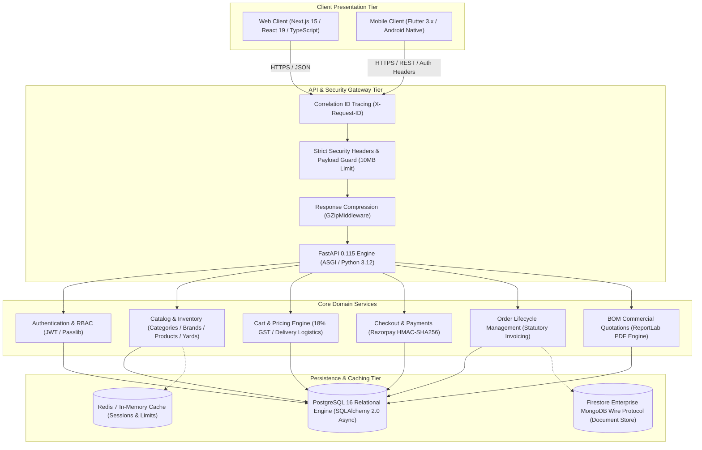

# BuildMart Engineering Wiki

Welcome to the official technical documentation and architecture reference for BuildMart.

BuildMart is a digital procurement and supply chain infrastructure platform purpose-built for the building construction industry. The platform bridges primary manufacturers (such as UltraTech, Tata Tiscon, Ambuja, and Berger) and certified regional material yards, enabling contractors, infrastructure developers, and builders to procure high-specification materials at transparent factory-direct prices with statutory 18% GST Input Tax Credit (ITC) compliance.

---

## System Topology Overview

---

## Documentation Navigation Matrix

The technical wiki is partitioned into deep-dive engineering manuals:

| Document | Scope and Technical Domain | Primary Reference |
| :--- | :--- | :--- |
| [Architecture](Architecture.md) | Enterprise 3-tier boundary breakdown, Monorepo layout, and request flows | [Architecture Guide](Architecture.md) |
| [Database and Persistence](Database-and-Persistence.md) | Dual-database design, PostgreSQL relational schema, Alembic migrations, and Firestore MongoDB wire protocol | [Database Manual](Database-and-Persistence.md) |
| [Authentication and Security](Authentication-and-Security.md) | JWT auth lifecycle, RBAC enforcement, cryptographic signature verification, and HTTP security policies | [Security Manual](Authentication-and-Security.md) |
| [Payments and Orders](Payments-and-Orders.md) | Razorpay checkout flow, HMAC-SHA256 verification, webhook replay protection, and order state machine | [Payments Manual](Payments-and-Orders.md) |
| [Mobile Engineering](Mobile-Engineering.md) | Flutter 3.x Android architecture, Riverpod 2 state, ProGuard R8 rules, and network resilience | [Mobile Manual](Mobile-Engineering.md) |
| [CI/CD and Quality Gates](CI-CD-and-Quality-Gates.md) | Multi-tier GitHub Actions workflows, Node 24 runtimes, automated secret auditing, and test suites | [CI/CD Manual](CI-CD-and-Quality-Gates.md) |
| [Deployment and Operations](Deployment-and-Operations.md) | Docker Compose topology, production readiness criteria, health checks, and environment configurations | [Operations Manual](Deployment-and-Operations.md) |

---

## Core Engineering Invariants

The BuildMart codebase enforces strict non-negotiable architectural invariants:

1. **Server-Authoritative Pricing and Inventory**:
   Client payloads never dictate item unit pricing, GST tax liability, or stock deductions. All order subtotals, statutory 18% GST taxes, delivery surcharges, and discount computations are executed strictly within the backend service using database-backed records.

2. **Durable Payment Verification**:
   No order is marked confirmed or transitioned to fulfillment without cryptographic HMAC-SHA256 signature verification matching the secret key held on the server. Webhook events are idempotently stored and deduplicated in the `webhook_events` audit table.

3. **Zero Untracked Secrets Policy**:
   API keys, database master credentials, JWT secrets, and payment signing secrets must reside strictly in protected environment variable stores or CI secret vaults. Active and valid secrets are strictly blocked from Git commits via pre-push audit gates.

4. **Multi-Platform Type Consistency**:
   Domain structures and payload schemas are maintained in the `@buildmart/shared` package and mirrored across backend Pydantic models, frontend Zod schemas, and mobile Freezed data classes.

5. **Resilient Network Timeouts**:
   All outbound network calls from mobile and web clients adhere to deterministic deadlines (15-second operation timeout on mobile) with explicit degradation fallbacks and structured error reporting.

---

## Technology Matrix

| Subsystem | Core Technologies | Specification / Version |
| :--- | :--- | :--- |
| **Monorepo Manager** | pnpm Workspaces, Turborepo | pnpm 12.4.2, Turborepo 2.x |
| **Frontend Web** | Next.js App Router, React, Tailwind CSS | Next.js 15.5, React 19.0, TypeScript 5.8 |
| **Web State Management** | Zustand | Persistent local storage & memory |
| **Backend API** | FastAPI, Starlette, Uvicorn | FastAPI 0.115, Python 3.12 |
| **Data Validation** | Pydantic v2 (API), Zod (Web/Shared) | Pydantic 2.x, Zod 3.23 |
| **Relational ORM** | SQLAlchemy 2.0 (AsyncIO), Alembic | SQLAlchemy 2.0.35, Alembic 1.13 |
| **Relational Storage** | PostgreSQL | PostgreSQL 16 (SQLite fallback for dev) |
| **NoSQL / Document** | PyMongo / Google Cloud Firestore | Enterprise MongoDB Compatibility Wire |
| **Document Generation** | ReportLab | Python PDF compilation engine |
| **Mobile Client** | Flutter, Dart | Flutter 3.x, Dart 3.x, Android SDK 34 |
| **Mobile State & Cache**| Riverpod 2, Freezed, FlutterSecureStorage | Hardware Keystore / Keyring backed |
| **Continuous Integration**| GitHub Actions | Ubuntu 24.04 runners, Node 24 native actions |
