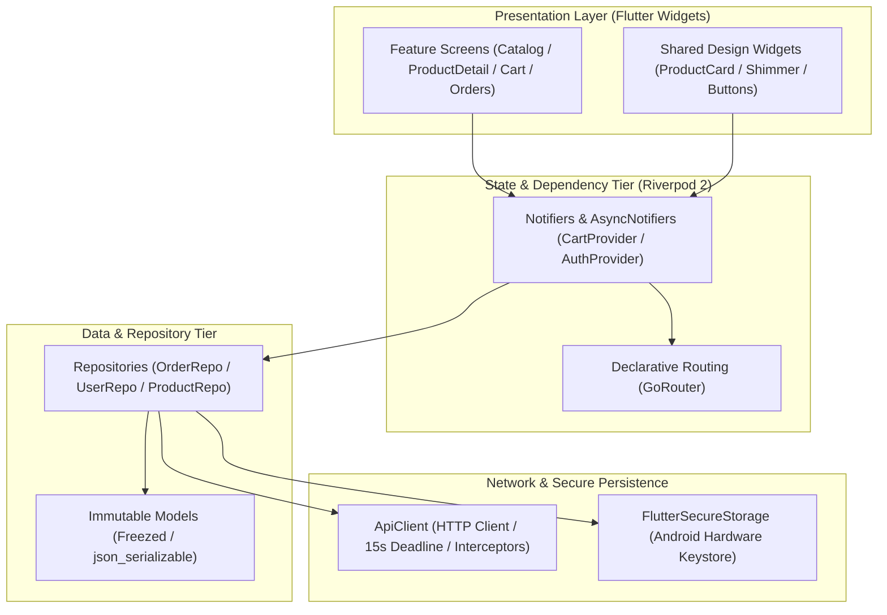
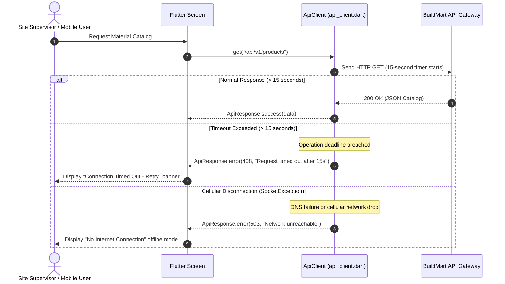

# Mobile Engineering Architecture

This document covers the Flutter 3.x mobile client architecture, Riverpod 2 state management, network resilience strategies, hardware keystore integration, and ProGuard / R8 release hardening.

Primary Source Files:
- [mobile/lib/main.dart](file:///d:/buildmart/mobile/lib/main.dart)
- [mobile/lib/core/services/api_client.dart](file:///d:/buildmart/mobile/lib/core/services/api_client.dart)
- [mobile/lib/core/security/secure_storage.dart](file:///d:/buildmart/mobile/lib/core/security/secure_storage.dart)
- [mobile/android/app/src/main/res/xml/network_security_config.xml](file:///d:/buildmart/mobile/android/app/src/main/res/xml/network_security_config.xml)
- [mobile/android/app/proguard-rules.pro](file:///d:/buildmart/mobile/android/app/proguard-rules.pro)
- [.github/workflows/flutter_ci.yml](file:///d:/buildmart/.github/workflows/flutter_ci.yml)

---

## Mobile Client Topology



---

## Network Timeout Resilience and Exception Translation

Mobile field connections at remote construction sites often experience high packet drop and variable latency. The HTTP client enforces a strict 15-second operation deadline on all requests with standardized HTTP-style degradation:



Implementation excerpt from [mobile/lib/core/services/api_client.dart](file:///d:/buildmart/mobile/lib/core/services/api_client.dart):
```dart
Future<ApiResponse<T>> _safeCall<T>(
  Future<http.Response> Function() requestFn,
  T Function(dynamic json) fromJson,
) async {
  try {
    final response = await requestFn().timeout(
      const Duration(seconds: 15),
      onTimeout: () {
        throw http.ClientException('Operation timed out after 15s');
      },
    );
    return _handleResponse(response, fromJson);
  } on SocketException {
    return ApiResponse.error(503, 'Network unreachable. Check your internet connection.');
  } on TimeoutException {
    return ApiResponse.error(408, 'Request timed out. Please try again.');
  }
}
```

---

## Hardware Keystore Credential Isolation

Authentication tokens are never written to unencrypted `SharedPreferences` or local SQLite files. Instead, `FlutterSecureStorage` delegates directly to the Android Keystore system:
- Encryption standard: AES-256 GCM.
- Key wrapping: RSA-2048 with hardware-backed security modules (StrongBox or TEE where supported).
- Stored tokens are retrieved asynchronously and injected into outbound request headers via `Authorization: Bearer <token>`.

---

## Android Release Hardening

### 1. Network Security Configuration
Cleartext (HTTP) network traffic is explicitly prohibited across the application bundle via [network_security_config.xml](file:///d:/buildmart/mobile/android/app/src/main/res/xml/network_security_config.xml):
```xml
<?xml version="1.0" encoding="utf-8"?>
<network-security-config>
    <base-config cleartextTrafficPermitted="false">
        <trust-anchors>
            <certificates src="system" />
        </trust-anchors>
    </base-config>
</network-security-config>
```

### 2. ProGuard and R8 Obfuscation Rules
To prevent reverse-engineering of commercial domain logic and protect serialization reflection, release builds apply rules configured in [mobile/android/app/proguard-rules.pro](file:///d:/buildmart/mobile/android/app/proguard-rules.pro):
- Preserves Flutter framework wrappers and platform channels.
- Preserves Freezed and JSON serialization data transfer objects.
- Obfuscates business logic classes and strips debug symbol tables.

---

## Continuous Integration & Automated Builds

The Flutter client is validated via GitHub Actions in [.github/workflows/flutter_ci.yml](file:///d:/buildmart/.github/workflows/flutter_ci.yml):
1. **Dart Code Formatting Check**: `dart format --output=none --set-exit-if-changed .`
2. **Dart Static Analysis**: `dart analyze --fatal-infos`
3. **Automated Unit & Widget Tests**: `flutter test --coverage`
4. **Release APK Compilation**: `flutter build apk --debug` to verify build reproducibility without signing secrets.
