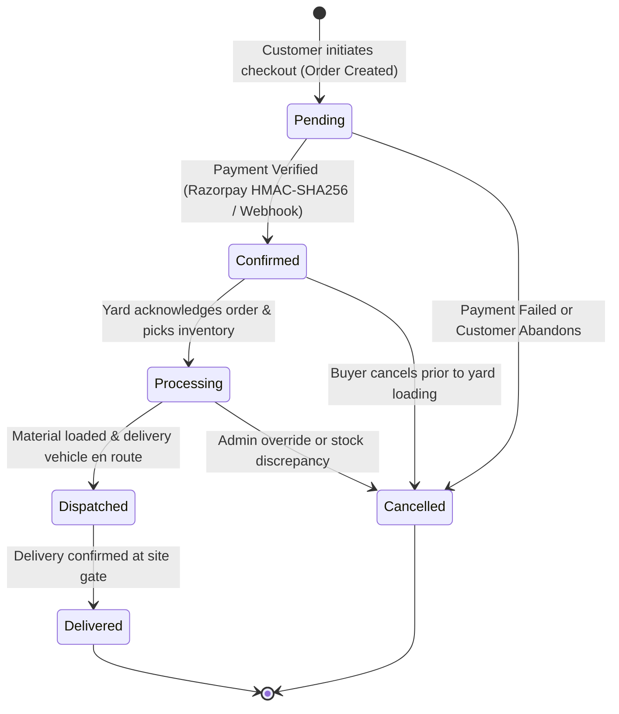
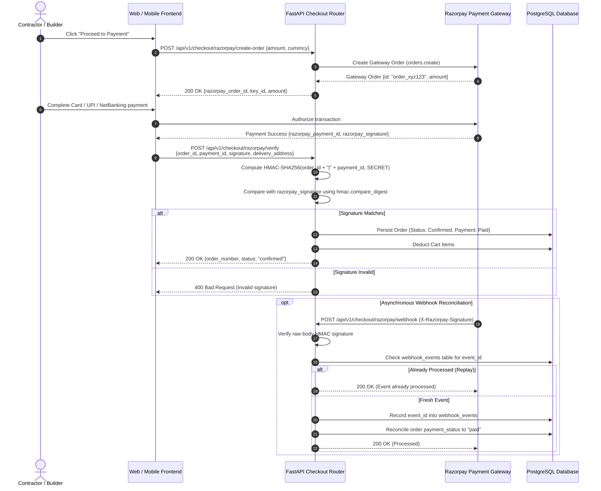

# Payments and Order Management Lifecycle

This document describes the commercial transaction architecture, Razorpay payment processing, cryptographic signature verification, webhook deduplication, and the formal order state machine.

Primary Source Files:
- [services/api/app/api/v1/checkout.py](../../services/api/app/api/v1/checkout.py)
- [services/api/app/api/v1/orders.py](../../services/api/app/api/v1/orders.py)
- [services/api/app/api/v1/quotes.py](../../services/api/app/api/v1/quotes.py)
- [services/api/app/models/models.py](../../services/api/app/models/models.py)
- [apps/web/src/app/checkout](../../apps/web/src/app/checkout)

---

## Order Lifecycle State Machine

Orders transition through formal state boundaries with strict transition guard rules:

### Transition Guard Rules:
- **Pending -> Confirmed**: Requires valid Razorpay payment signature or verified Cash-on-Delivery approval.
- **Confirmed -> Cancelled**: Allowed if logistics status is not yet marked `dispatched`.
- **Dispatched -> Cancelled**: Forbidden. Once logistics fleet is in transit, cancellation must be processed via physical return protocol.
- **Delivered**: Final terminal state. Generates final GST tax invoice.

---

## Payment Verification Sequence (Razorpay HMAC-SHA256)

Payment authenticity is guaranteed through dual-channel verification (synchronous client callback and asynchronous gateway webhook):

---

## Statutory 18% GST Construction Tax Invariant

All order and quotation computations follow server-authoritative statutory taxation rules:

$$\text{Subtotal} = \sum_{i=1}^{n} (\text{UnitPrice}_i \times \text{Quantity}_i)$$

$$\text{GST Tax (18\%)} = \text{Subtotal} \times 0.18$$

$$\text{Delivery Fee} = \begin{cases} 0.00 & \text{if Subtotal} \ge 10{,}000 \\ 500.00 & \text{otherwise} \end{cases}$$

$$\text{Total Amount} = \text{Subtotal} + \text{GST Tax} + \text{Delivery Fee}$$

Client-submitted tax rates, discounts, or delivery fees are discarded. The server computes all values against authoritative database prices and inserts frozen price snapshots into `order_items`.

---

## Commercial Bill of Materials (BOM) Quotations

Contractors requiring client or bank estimation approvals can submit a Bill of Materials for automated commercial quotation generation.

- **Submission Endpoint**: `POST /api/v1/quotes`
- **Dynamic PDF Compilation**: `GET /api/v1/quotes/{id}/pdf`
  - Utilizes ReportLab to compile branded, audit-ready engineering quotations.
  - Includes contractor details, project site delivery pincode, itemized materials, statutory GST breakdown, and legal terms of validity.
